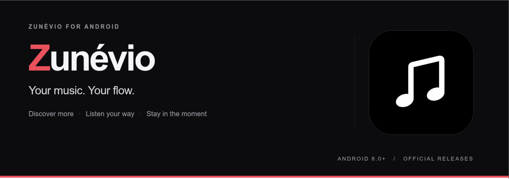
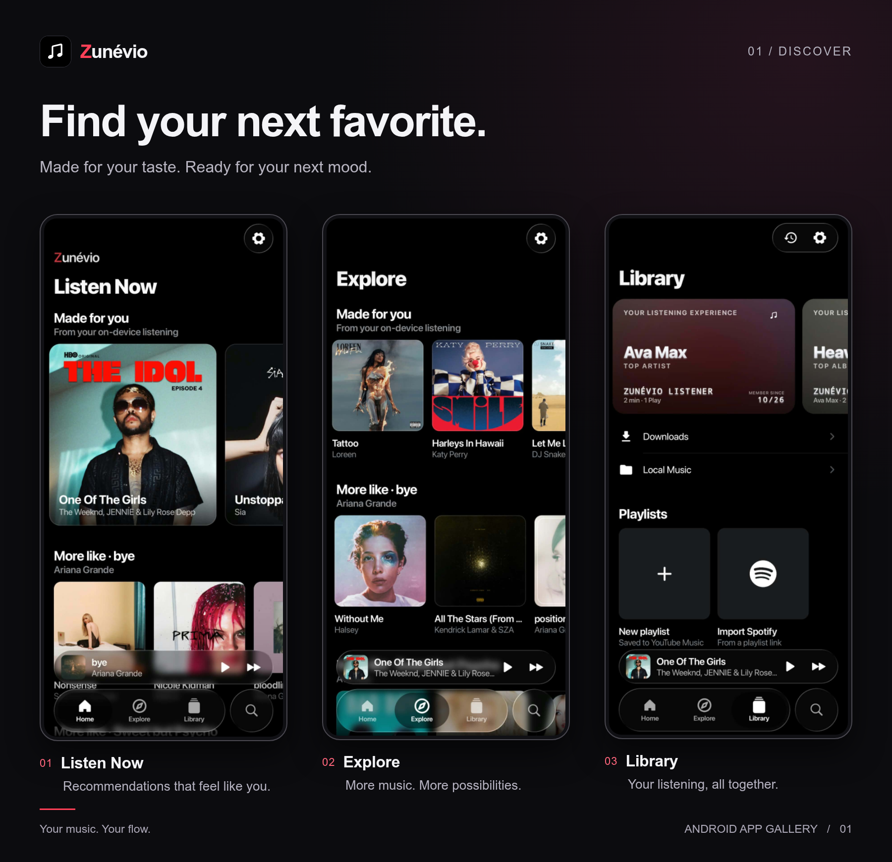
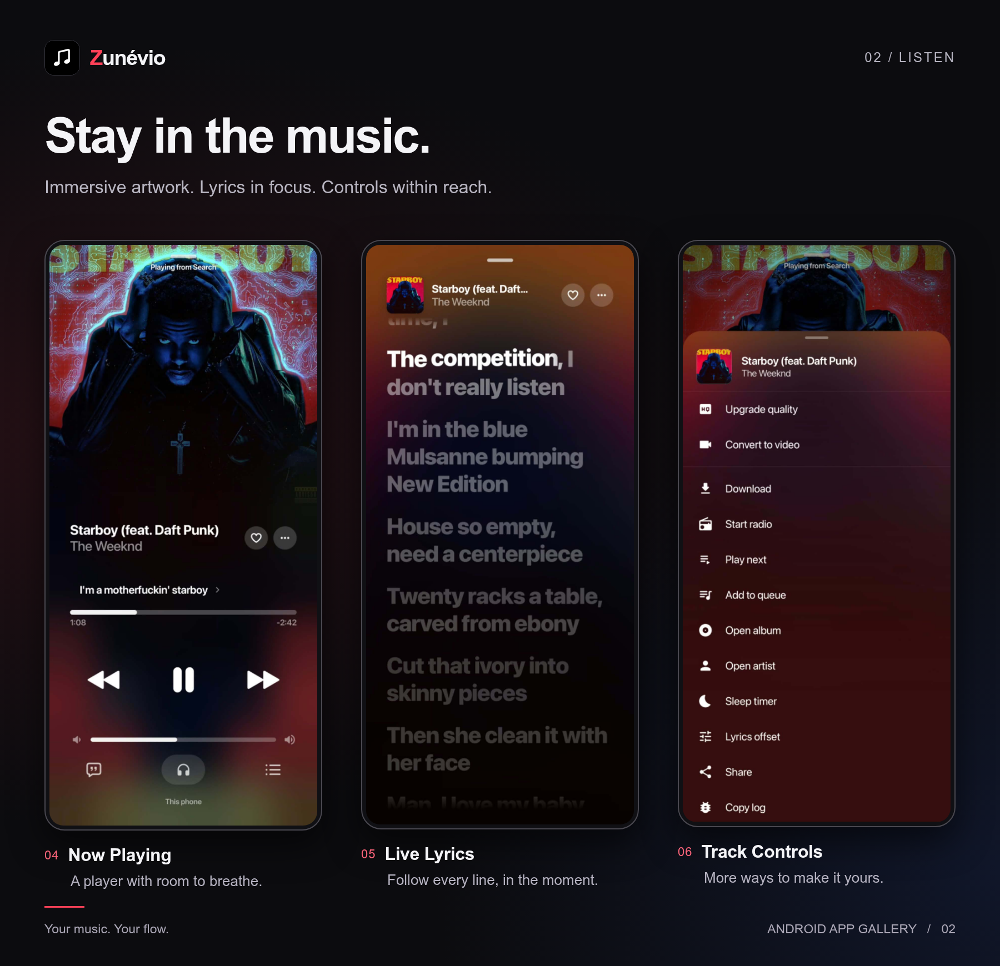
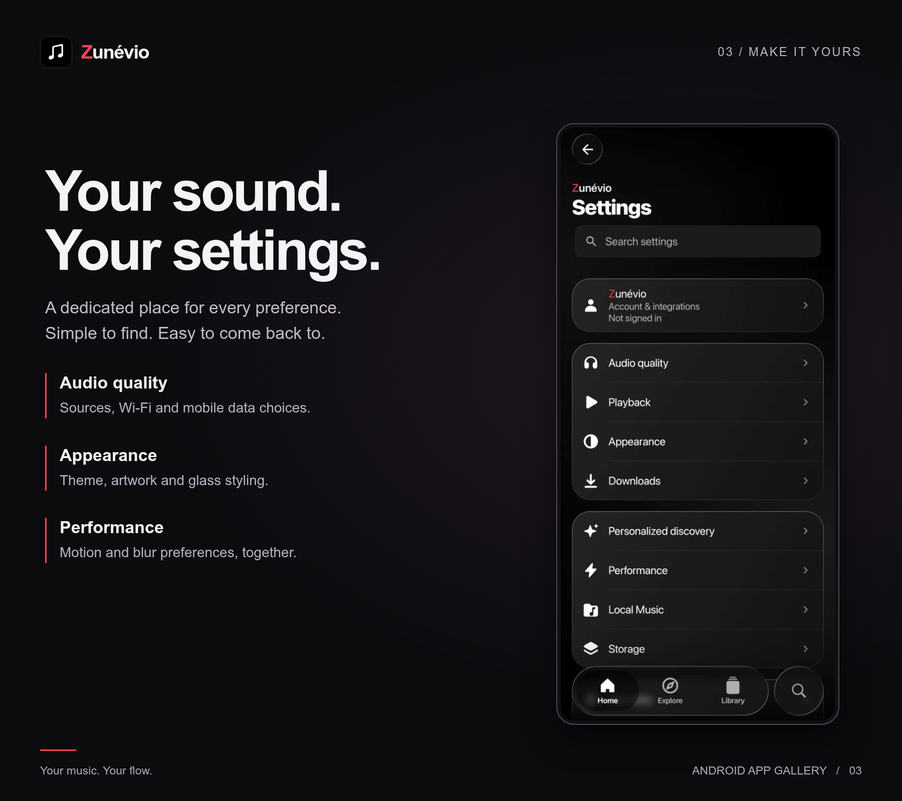

# Zunéviu
### Your music. Your flow.

A fresh look. A more reliable way to stay up to date.

# Zunéviu 1.5.5

### Liquid Glass and motion
- More transparent glass for floating navigation, the mini-player and selected menus, dialogs and player controls. Adjust transparency, frost, background reflection, highlights and tint independently in Settings.
- A reflected sample of the underlying content on supported Android 13+ devices, with translucent/static fallbacks on older or low-memory devices. Menu panels and the active mini-player have subtle moving highlights.
- Three-dot menus open from and close toward their button; shared press and toggle springs have been refined. Reduced-motion and reduced-blur settings remain available.
- The Settings page keeps its existing appearance while glass controls change. The app icon is unchanged.

### Discover, search and playback
- Updated Home category selection and music shelves, with better deduplication and compact track rows where supported by the feed.
- Song recognition is accessible from Search; microphone permission and a network connection are required.
- Improved handling of selected videos from Search and artist shelves, and prevent lyrics from the previous recording appearing while a new video loads.
- Follow actions provide clearer feedback when sign-in or subscription information is unavailable. Guest listening remains available.

### About, support and compatibility
- Added an About area with version and update information and a support page. The bKash number is hidden until tapped; copying and opening bKash require an explicit action.
- Added translations for the new glass and support settings.
- The app no longer supplies an inherited Listen Together server default. The source targets Android mobile rather than the removed desktop and Wear OS targets.
- Package identity and production signing are retained. Version name is 1.5.5 and Android version code is 90.

## Download

**Android 8.0+**

| Edition | Best for |
| --- | --- |
| [ARM64 APK](https://github.com/amitsami/zunevio-releases/releases/download/v1.5.5/Zunevio-1.5.5-arm64.apk) | Compatible 64-bit ARM devices |
| [Universal APK](https://github.com/amitsami/zunevio-releases/releases/download/v1.5.5/Zunevio-1.5.5-universal.apk) | Choose this if you are unsure |

Download one APK and install it over your existing Zunéviu app to keep your library and settings. Do not uninstall or clear app data just to update. Android manages installation permissions and prompts.

Choose **White Glass** in the app’s icon settings to try the new look.

[Official website](https://amitsami.github.io/zuneviu-website/) · [Latest release](https://github.com/amitsami/zunevio-releases/releases/latest)

## App gallery

*Screenshots from v1.2.6.*

### Discover your next favorite

### Stay in the music

### Make it yours

## Source
 Build instructions, licenses and required copyright notices are included. Use this named source ZIP for the app; GitHub’s automatically generated source archives describe the download repository instead.
