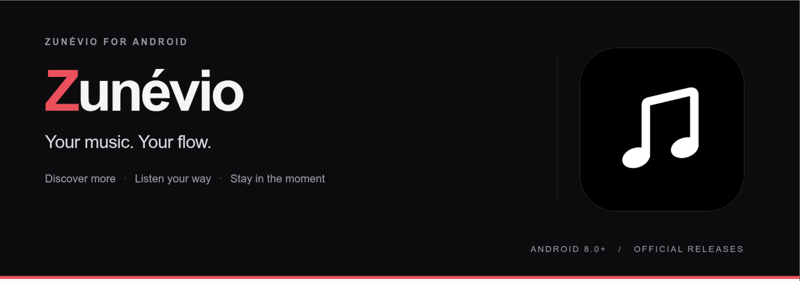
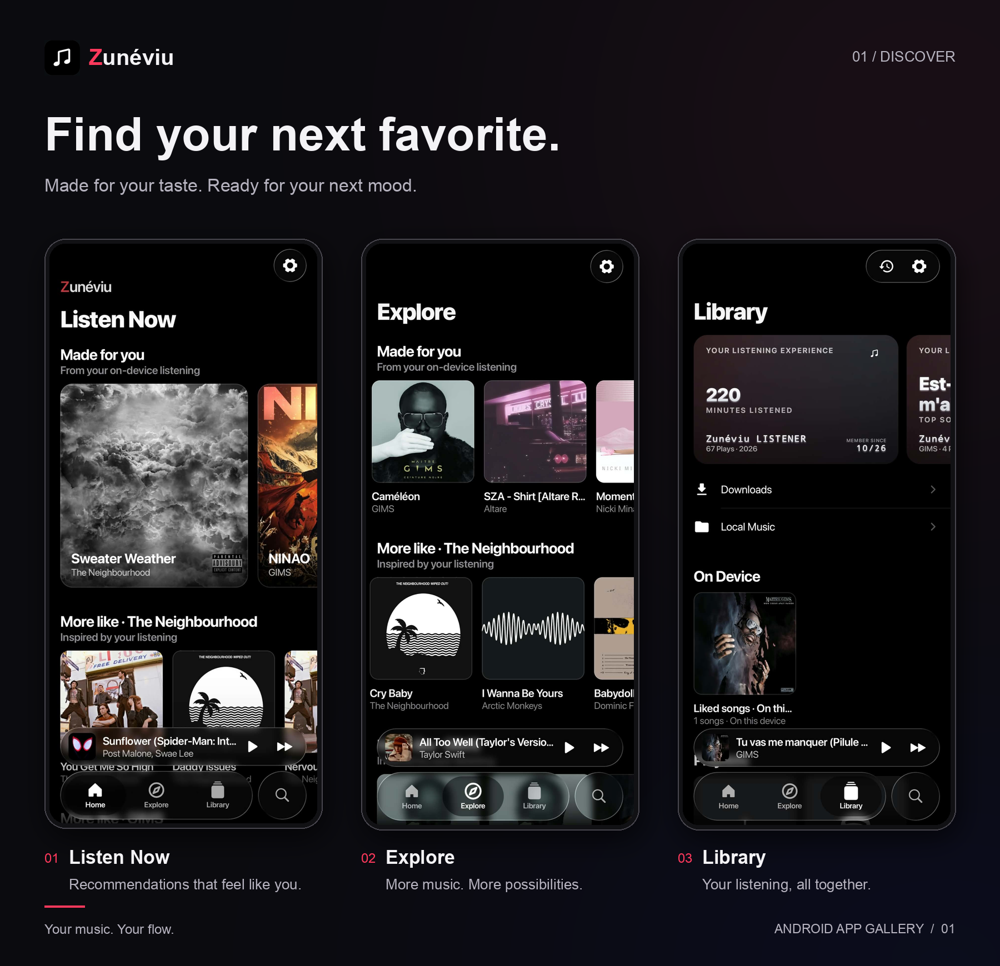
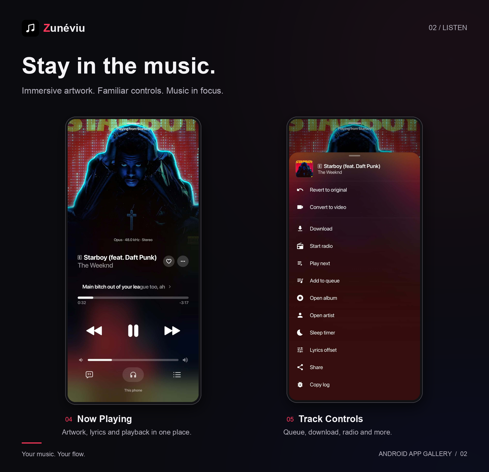
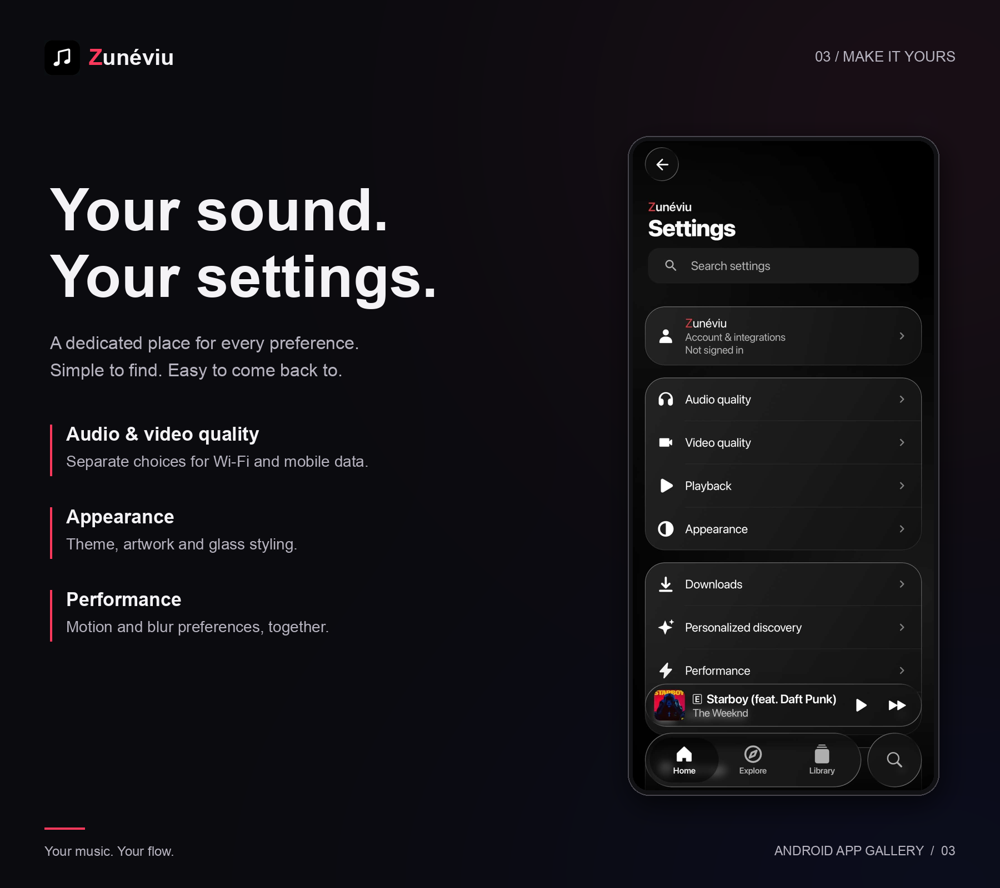

# Zunéviu
### Your music. Your flow.

A focused Android music experience with clean lyrics, personal discovery and settings that stay out of your way.

[**Download the latest release →**](https://github.com/amitsami/zunevio-releases/releases/latest) · [All versions & changelogs](https://github.com/amitsami/zunevio-releases/releases) · [Privacy](PRIVACY.md)

---

## App gallery

Updated with owner-provided screenshots for the v1.2.6 release. The first banner is unchanged.

### Discover your next favorite

Personal recommendations, Explore and your listening library.

### Stay in the music

Immersive artwork and track controls within reach.

### Make it yours

Dedicated settings for audio quality, playback, appearance and performance.

---

## Latest update — 1.2.6 (Build 51)

- Dedicated native Spotify sign-in screen, stable page lifecycle and explicit Retry.
- Google session readiness improvements; video availability checks and a static “Lyrics >” entry.
- Stream buffering improvements, equalizer/branding fixes and reduced disposable-cache budgets.
- Approved new gallery cards; the original banner is unchanged.
- [Full changelog, validation and known limitations](RELEASE_NOTES.md).

Genius live-fetch remains blocked with HTTP 403 in the build environment. Spotify device/account acceptance is not established by automated tests; no universal login or sync guarantee is claimed.

## Made for everyday listening

- **Clean player** — single-line lyrics and a visible favorite heart.
- **Personal discovery** — refreshed Explore recommendations and a guest-friendly Library.
- **Focused settings** — individual category pages, readable switches and remembered scroll positions.
- **Updates inside the app** — changelog, verified APK download and Android's installation confirmation. No GitHub visit needed for future updates.
- **Optional update alerts** — allow Android notifications to hear when a new stable version is found.

## Install

1. Open the latest release and download **Zuneviu-…-universal.apk**.
2. Open the APK and allow installation for the app you downloaded it with, if Android asks.
3. Keep Play Protect enabled. Review any Android warning; never bypass it blindly.

**Requirements:** Android 8.0 or later. One universal APK supports ARM, ARM64, x86 and x86_64; individual device compatibility and provider availability can vary.

### Moving from a preview?

The old debug-signed preview is not the production signing chain. The production package is `com.zunevio.music`, separate from `preview3`. Install the production app separately and keep the preview until you have migrated any needed data. Future official updates use the same production certificate and increasing version codes.

## How updates work

Zunéviu checks this public release channel on app open, on demand, and approximately every 12 hours in the background. Android permission, battery policies and network availability affect phone notifications; this is not instant push. A repository commit alone is not an app update—a newer stable release with its APK must be published.

Downloads happen only when you choose. The app verifies the SHA-256 digest, package, signing certificate and newer version code before opening Android's installer. Android always controls installation and requires your confirmation.

## Transparency

The v1.2.6 release includes the APK, changelog, SHA-256 checksums, certificate details and validation report. Its complete corresponding source and rebuild inputs are in [source/](source/) and the immutable [v1.2.6 source tree](https://github.com/amitsami/zunevio-releases/tree/v1.2.6/source). From the GitHub automatic source archive, run builds from the `source/` directory following its BUILDING.md. No separately uploaded source ZIP asset is needed for this version. Historical releases retain their own corresponding-source assets for their exact binaries.

See [License](LICENSE), [Notices](NOTICE.md), [Third-party notices](THIRD_PARTY_NOTICES.md) and [Privacy](PRIVACY.md). Required upstream credits are retained in those notices and the corresponding source. Zunéviu is independent and is not endorsed by music providers or upstream projects.

No warranty, Play Protect certification, silent install, universal device smoothness guarantee or on-device future-update certification is claimed. Consult each release's validation report and known limitations.

---

**Zunéviu** · Android music app · Maintained by [Amit Hasan Sami](https://github.com/amitsami)
